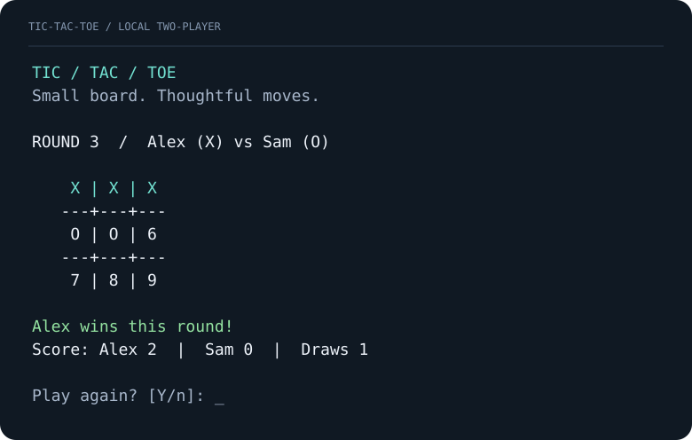

# Tic / Tac / Toe

**Small board. Thoughtful moves.**

A clean terminal version of the classic. Play a friend on the same keyboard or
challenge the computer, then come back to a scoreboard that remembers your games.

**Python 3.10+ · No runtime dependencies · macOS, Linux & Windows · MIT**



## Play in a minute

```bash
git clone https://github.com/Soumil-Makhija/tic-tac-toe.git
cd tic-tac-toe
python3 play.py
```

Choose **1** for the computer, **2** for a friend, or **3** for saved scores.
Enter a square number to place your mark:

```text
    1 | 2 | 3
   ---+---+---
    4 | 5 | 6
   ---+---+---
    7 | 8 | 9
```

**X always starts.** Get three marks in a row, column, or diagonal to win.
A full board without a winner is a draw. Taken squares and invalid input are
rejected without losing your turn. After each round, press Enter to play again
or enter `n` to finish. Rematches swap marks so both players take turns starting.
Enter `q` at any prompt to leave; unfinished rounds never count toward scores.

On Windows, use `py -3` wherever the examples use `python3`.

## Choose your game

```bash
# An unbeatable computer opponent
python3 play.py --mode solo --name Alex

# A relaxed game, starting as O
python3 play.py --mode solo --difficulty easy --mark O --name Alex

# Two people, one keyboard
python3 play.py --mode local --name Alex --opponent Sam

# Practice without reading or writing saved scores
python3 play.py --mode solo --no-save

# Review results from previous sessions
python3 play.py --scores
```

| Difficulty | How the computer plays |
| --- | --- |
| `easy` | Picks a random available square. |
| `medium` | Takes an immediate win, otherwise blocks an immediate threat, otherwise plays randomly. |
| `hard` (default) | Searches every continuation using minimax. It cannot lose; perfect play earns a draw. |

Names can contain 1–24 printable characters, including spaces when quoted.
Players in a matchup must have distinct names, ignoring case. Names are otherwise
case sensitive in saved scores. The computer is always called `Computer`.
In local mode, `--mark` sets the first player's mark for the first round;
`--difficulty` has no effect.

## A scoreboard that stays with you

Every completed round is saved immediately, before the replay prompt. Results are
grouped by mode, difficulty, and the ordered pair of player names. Each group
tracks both players' wins and draws; swapping X and O during a rematch does not
change that group. Keep using the same names and command to continue a matchup.
Reversing `--name` and `--opponent` creates a separate local matchup.

Scores live in a local SQLite database outside this checkout:

| Platform | Default location |
| --- | --- |
| macOS | `~/Library/Application Support/tic-tac-toe/scores.sqlite3` |
| Linux | `$XDG_DATA_HOME/tic-tac-toe/scores.sqlite3`, or `~/.local/share/tic-tac-toe/scores.sqlite3` |
| Windows | `%LOCALAPPDATA%\tic-tac-toe\scores.sqlite3` |

Use `--data-dir PATH` or the `TIC_TAC_TOE_HOME` environment variable to choose
another directory. The command-line option takes precedence. Reading an empty
scoreboard creates no files. `--no-save` keeps scores for the current session
only and never opens the database during play. `--scores` always shows saved scores.

SQLite transactions protect completed-round writes. Storage errors are reported
without silently resetting your history. If saving a finished round fails, the
game exits with an error; that round may not have been recorded. For a damaged
database, preserve the file and use a new `--data-dir` or `--no-save` to keep
playing. To start a fresh scoreboard, use another data directory. Back up the
database while the game is closed if you want to keep your history.

Everything runs offline. Names and results remain on your computer, in an
unencrypted database. There are no accounts or network calls.

## Terminal behavior

The board uses ASCII characters with numbered empty squares. X and O remain
distinct without color, and winning marks appear green when color is available.
The interface uses ordinary line input and preserves the transcript instead of
clearing the screen. It requires no mouse.

Use `--no-color` to disable ANSI colors. `NO_COLOR`, `TERM=dumb`, redirected
output, and Windows also disable colors. Without `--mode`, noninteractive input
prints help rather than opening the menu. Explicit `--mode` supports piped moves.
EOF exits cleanly; Ctrl+C returns exit code `130`.
Other exit codes: `0` normal completion, `1` storage or player configuration
error, `2` argument usage error.

```bash
python3 play.py --help
python3 -m tic_tac_toe --version
```

## Optional installation

Run directly from the checkout, or install the terminal command in a virtual environment:

```bash
python3 -m venv .venv
source .venv/bin/activate
python -m pip install .
tic-tac-toe --mode solo
```

On Windows PowerShell, activate with `.venv\Scripts\Activate.ps1`.

## Development

```bash
python3 -m unittest discover -s tests -v
python3 scripts/render_preview.py
```

The engine in `tic_tac_toe/game.py` is independent of the terminal.
`cli.py` handles interaction, and `scores.py` manages local storage.
Tests cover all eight winning lines for both marks, legal and illegal moves,
draws, opponent behavior, full terminal rounds, replay, quitting, and durable scores.
An exhaustive traversal checks every human reply against hard mode playing each
mark. Tests use temporary directories and synthetic scores.

GitHub Actions runs tests and package installation on Linux, macOS, and Windows
with Python 3.10 and 3.14. The preview is an illustrative game, generated from the
same board renderer used during play.

## License

[MIT](LICENSE) © 2026 Soumil Makhija.
